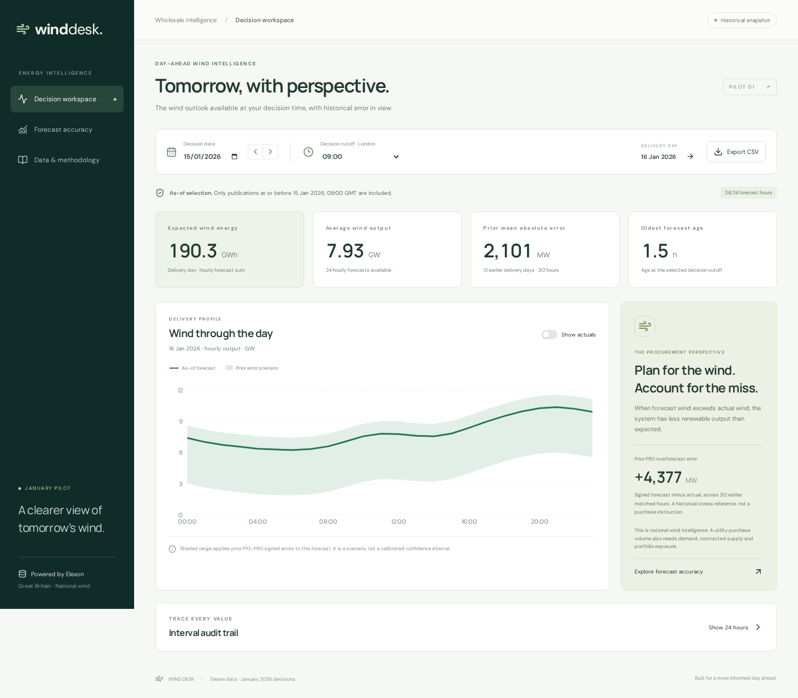

# Wind Desk

A React + Python pilot for reviewing the wind forecast available **at a January 2026 day-ahead purchase decision**, and measuring how that forecast performed. Uses real Elexon WINDFOR and FUELHH WIND data only.

The application has three views:

- **Decision workspace:** select a January decision date and London-time cutoff, inspect the next day’s hourly forecast, publication age and prior error scenarios. Actuals are an explicitly retrospective overlay.
- **Forecast accuracy:** MAE, RMSE, signed bias, WAPE, percentile error, coverage, daily drill-down and time-of-day patterns.
- **Data & methodology:** source links, snapshot provenance, metric definitions, alignment assumptions and limitations.

CSV exports retain decision cutoff, publication timestamp, forecast lead time, actuals and signed error.

For a visual explanation of the project's purpose, data flow and architecture, open [the Mermaid project overview](docs/project-overview.mmd) in a Mermaid-compatible viewer.



## Run with Docker

Requires Docker Engine and Docker Compose.

```bash
docker compose up --build
```

Open **http://localhost:8000**. API documentation: **http://localhost:8000/api/docs**.

```bash
docker compose down
```

The multi-stage image builds the React frontend and serves it with FastAPI under one origin. The runtime uses an unprivileged user and includes a health check. The real January snapshot is bundled: no API keys or ingestion step are required to start the app.

## Local development

Tested with Node 24, Python 3.14 locally and Python 3.13 in Docker.

```bash
python3 -m venv .venv
source .venv/bin/activate
pip install -r requirements-dev.txt
uvicorn backend.main:app --reload --port 8000
```

In another terminal:

```bash
cd frontend
npm ci
npm run dev
```

Open http://localhost:5173. Vite proxies `/api` to port 8000. For a production frontend build, run `npm run build` in `frontend/`, then restart FastAPI to serve `frontend/dist/`.

## Verify

```bash
.venv/bin/python -m pytest -q
npm ci --prefix frontend
npm run build --prefix frontend
```

With the built application running on port 8000:

```bash
cd frontend
npx playwright install chromium
npm run test:e2e
```

Set `BASE_URL` to test another running instance, e.g. `BASE_URL=http://127.0.0.1:8001 npm run test:e2e`. On Linux CI, `npx playwright install --with-deps chromium` installs browser system dependencies.

Tests cover cutoff inclusivity, later-forecast exclusion, partial actual coverage, duplicates, invalid values, month boundaries, historical revision leakage, metric arithmetic, CSV/API consistency, input validation, browser navigation, export, failure recovery and mobile layout. GitHub Actions builds and tests the app and its Docker image.

## Data and analytical contract

**Scope:** decisions 1–31 January 2026 → deliveries 2 January–1 February 2026. London is GMT throughout. This is a reproducible historical pilot, not a live feed.

**Selection:** for each delivery timestamp, choose the maximum `publishTime` at or before that decision’s cutoff. Default **09:00 Europe/London** is a configurable pilot assumption, not a claim about a universal exchange deadline. Both date and cutoff affect the selected forecast. The full-month accuracy screen applies the chosen cutoff to every January decision.

**Alignment:** the supplied snapshot contains 744 distinct hourly WINDFOR targets and 1,488 half-hour FUELHH WIND actuals. We explicitly interpret each forecast timestamp as the start of an hourly period and compare it with the mean of the :00 and :30 actuals. This forecast-period interpretation needs confirmation with the data owner before operational use. Both half-hours are required. Missing values stay missing; daily energy is withheld unless all 24 forecast hours exist.

**Units:** power is MW. Daily forecast energy = sum of hourly MW × 1 hour; displayed as GWh. Error = forecast − actual; positive error is an overforecast of wind.

**Prior error scenarios:** only earlier complete delivery dates are eligible, and actual revisions are selected as of the current decision cutoff. Five prior delivery days are required for the displayed range. The range is `forecast − P90(error)` through `forecast − P10(error)`, clipped at zero. These empirical scenarios are not calibrated prediction intervals and do not imply independent hourly errors. Full-month backtest statistics are never used to construct a historical decision’s scenario.

**Data limits:** wind operationally visible to the GB system, not an estimate of every UK wind asset. No demand, prices, contracts or portfolio allocation are available, so this app cannot calculate a utility’s net procurement volume. It also does not attribute forecast misses to weather or curtailment.

At 09:00, this snapshot yields **744/744 matched hours**, **MAE 2,038.9 MW**, **RMSE 2,504.8 MW**, **bias +1,747.9 MW**, and **WAPE 18.07%**. These are retrospective results conditional on the scope and alignment above, not guaranteed future performance. See [analysis](docs/analysis.md).

### Rebuild the snapshot

```bash
python3 scripts/ingest.py
```

The standard-library ingestion script queries the two specified stream endpoints by publication day, uses four concurrent workers with timeouts/retries, filters WIND actuals and target dates, deduplicates inclusive boundary records and writes a compressed snapshot plus manifest. Forecast publication queries cover 30 December 2025–31 January 2026; actual publication queries cover 2 January–3 February 2026, including the last query’s upper boundary. Older forecasts and later actual revisions are outside the collection window. Restart the backend after refresh to invalidate its in-memory caches.

The manifest records every request, received/retained counts, retrieval time, date scope and the uncompressed payload’s SHA-256. Loading fails if the checksum differs. The app makes no runtime network calls to Elexon; upstream downtime does not break the bundled pilot.

## Structure

```text
backend/
  main.py           FastAPI composition root; static frontend serving
  routes.py         HTTP validation, dependency injection and CSV serialization
  repository.py     Compressed snapshot loading and integrity verification
  service.py        Application use cases and bounded cutoff cache
  analytics.py      Pure as-of selection, alignment, history and scoring
frontend/
  src/App.tsx       Application navigation and shared decision state
  src/components/   Sidebar, decision controls and reusable metric cards
  src/pages/        Decision workspace, accuracy and methodology views
  src/hooks/        Cancellable, typed data-loading hook
  src/lib/          HTTP transport and display formatting
  src/types.ts      Domain contracts for API responses
  src/styles.css    Responsive visual system
  e2e/              Playwright workflows and mobile checks
  package-lock.json Reproducible frontend dependency resolution
data/
  elexon.json.gz    Real source records, compressed
  manifest.json    Query provenance and checksum
scripts/ingest.py   Reproducible Elexon ingestion command
tests/             Analytics and API tests
docs/              Architecture, findings, client pitch and screenshot
api/index.py       Vercel Python entry point
Dockerfile         Multi-stage React build / Python runtime
compose.yaml       Local container startup
vercel.json        Vercel frontend build and Python API routing
heroku.yml         Heroku container build definition
Procfile           Optional Python process definition
.github/workflows/ CI build, backend, browser and Docker checks
```

### Design principles

The design follows SOLID and DRY through focused responsibilities and composition rather than unnecessary inheritance. Filesystem access is confined to the repository; the service receives its dataset through its constructor; FastAPI injects the service; HTTP routes do not implement analytics. The same as-of selector and metric function power the workspace, backtest and export. Frontend pages consume typed data, a shared hook owns request lifecycle/cancellation, and formatting and controls are reused. See [architecture](docs/architecture.md) for tradeoffs and extension points.

## Deployment status

**No hosted app URL:** deployment, video and form submission were excluded by the updated project scope. This repository includes deployment configuration, but neither hosted route has been deployed or verified.

- **Vercel:** import the repository with its root directory unchanged. `vercel.json` builds `frontend/dist` and routes `/api/*` to `api/index.py`, which imports the FastAPI app. The Python function includes the data snapshot. Review production access settings and test `/`, `/api/health`, `/api/day` and CSV export after deployment.
- **Heroku:** create an app using the container stack and deploy this repository’s `heroku.yml`. The image honors Heroku’s `$PORT`. The container has been built and tested locally.

Do not use the single-process `Procfile` with a plain Python buildpack without separately building the React assets; the Docker/Heroku container path does that automatically.

## AI assistance

**OpenAI Codex was used** for domain research, application implementation, refactoring, documentation, and test generation/execution. The app does not call AI services at runtime. No synthetic generation data is used.

## Sources

- [Elexon FUELHH stream documentation](https://bmrs.elexon.co.uk/api-documentation/endpoint/datasets/FUELHH/stream)
- [Elexon WINDFOR stream documentation](https://bmrs.elexon.co.uk/api-documentation/endpoint/datasets/WINDFOR/stream)
- [Elexon wind forecast coverage description](https://bmrs.elexon.co.uk/api-documentation/endpoint/forecast/generation/wind/latest)
- [Vercel FastAPI documentation](https://vercel.com/docs/frameworks/backend/fastapi)

Elexon is the source of the data, not the sponsor of this pilot. Source data remains subject to its provider’s terms.
