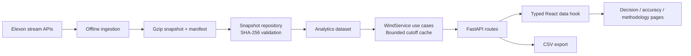

# Technical review

## Request and data flow

The same container serves the built React application and the Python API. The frontend uses relative API URLs, so local production needs neither a CORS allowlist nor separate backend configuration. Development uses a Vite proxy.

## Boundaries and SOLID

- **Single responsibility:** repository reads and verifies files; analytics selects/aligns/scores records; service assembles use-case results; routes validate HTTP inputs and serialize output; React components render state.
- **Open for extension:** alternative persistence can construct the same domain dataset without changing the analytic selector. Another API view can call the service. Chart/report additions reuse metrics and row contracts.
- **Composition over inheritance:** there is no artificial class hierarchy, so Liskov substitution is not forced onto a model that does not need it. A future data-source protocol should be introduced when a second implementation exists.
- **Small interfaces:** clients call day, month accuracy, metadata or export endpoints. UI components receive only the state/callbacks they use. `DaySummary` excludes row/history fields not returned by the monthly endpoint.
- **Dependency inversion:** `WindService` receives the analytic dataset; it never opens a file. HTTP dependencies are replaceable through FastAPI dependency overrides. Pure analytic tests require no web server or filesystem.
- **DRY:** one timestamp parser, one latest-before-cutoff selector, one metric function and one monthly selection cache. CSV serializes the selected rows used by the UI. React shares formatting, metric cards, date/cutoff controls, transport and request cancellation.

These are practical boundaries for a small pilot. A database, message broker, authentication subsystem and generalized forecasting framework would add operational work without improving this fixed-month demonstration.

## Algorithm

1. Parse timezone-aware timestamps; validate finite, nonnegative generation.
2. Index records by target timestamp and publication time. Equal duplicate values collapse. Conflicting values with identical keys fail explicitly.
3. For every January decision, create the following day’s 24 hourly targets.
4. Select the latest forecast published at or before that decision’s London cutoff.
5. Select the latest actual records in the bounded snapshot; average the two half-hours only when both exist.
6. Score matched rows; retain nulls and denominators for missing data.
7. For historical scenarios, revisit only completed delivery dates before the current decision date, reselect actuals at that current cutoff and calculate empirical signed-error quantiles. Later actual revisions cannot leak into the scenario.

The January-only `24` hour loop is deliberate: all dates in this pilot have 24 hours. An all-year extension must generate delivery intervals between successive London midnights in UTC, including 23/25-hour DST days; it must not reuse the fixed count.

## Reproducibility and performance

The source snapshot is about 113 KB compressed. All forecast vintages are retained within the collection window. Data loads once per worker, and monthly results are cached for at most 64 cutoff values. The API accepts valid minute-level cutoffs; the UI offers a smaller set. There is no mutable production database and no public refresh endpoint. A snapshot refresh is an offline command followed by application restart.

The cache returns read-only-by-convention results: routes and services construct new export/history objects and never mutate cached days. A larger implementation should formalize immutable models and replace untyped Python result dictionaries with validated response models. TypeScript is strict, but JSON casts are compile-time contracts rather than runtime schema validation.

## Error handling and trust

- Invalid dates or cutoff strings return HTTP 422.
- Missing forecast/actual intervals stay null and lower coverage; there is no silent forward fill.
- Empty metric sets return null metrics, not misleading zero error.
- A checksum mismatch prevents loading corrupted/mismatched snapshot files.
- Browser requests use AbortController so an obsolete response cannot replace a newer selection.
- Failures present a retry action; stale figures are hidden while new data loads.
- No secrets or personal data are required, and there are no external writes from the application.
- The runtime container is non-root, with separate frontend build and Python runtime stages.

## Tradeoffs and next operational steps

The pilot assumes an hourly period interpretation of WINDFOR and validates observed timestamp resolution. Confirm this with Elexon before treating the energy total or hourly-average comparison as settlement-quality. Compare source coverage before assuming forecast bias represents a weather-model flaw.

Operational production would need the client’s exchange/cutoff, ingestion latency and publication availability policy, a persistent versioned dataset, freshness monitoring, source revisions, retries beyond a single offline run, portfolio exposure/demand inputs, access control and calibrated out-of-sample uncertainty. `publishTime` is the best available historical availability proxy; it does not prove the client actually received the forecast at that instant.

## Review path

1. Read `tests/test_analytics.py` for the behavioral contract.
2. Review `backend/analytics.py`, especially `latest`, `day`, and `history`.
3. Follow `repository.py` → `service.py` → `routes.py`.
4. Review `frontend/src/types.ts`, `hooks/useWindData.ts`, and the page components.
5. Run pytest, build the frontend, then run Playwright against Docker.
6. Inspect `data/manifest.json` and reproduce the findings in `docs/analysis.md`.
